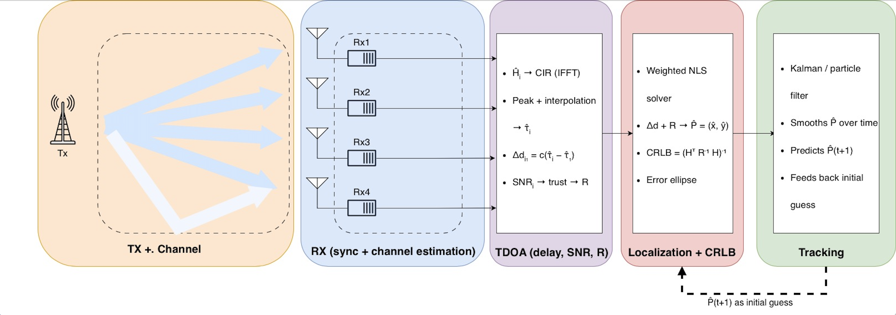

# Wi-Fi TDoA Localization (ISAC Capstone 26–27)

Localize a Wi-Fi transmitter with 4 synchronized receivers using Time Difference of Arrival (TDoA).
The chain is split into **5 independent blocks**. Each person owns one block, works alone, and plugs in at the end.



Full guide per block: **[docs/TDoA_Team_Work_Split.pdf](docs/TDoA_Team_Work_Split.pdf)**

---

## Folder structure

```
wifi-tdoa-localization/
├── config.m              shared settings (everyone reads, integrator edits)
├── README.md
├── src/
│   ├── main.m            full chain, Block 1 → 5 (integrator)
│   ├── blk1_txChannel.m  Block 1 – TX + Channel
│   ├── blk2_rx.m         Block 2 – RX (sync + channel estimation)
│   ├── blk3_tdoa.m       Block 3 – TDoA (delay, SNR, R)
│   ├── blk4_localize.m   Block 4 – Localization + CRLB
│   └── blk5_track.m      Block 5 – Tracking
├── tests/
│   └── test_blk1.m … test_blk5.m   standalone test per block (fake inputs)
├── utils/
│   ├── checkIO.m         checks your outputs match the contract
│   └── plotScene.m       plots RX, walls, true TX, estimate + ellipse
├── docs/                 work-split PDF + block diagram
└── results/              figures / data (git-ignored)
```

Put helper functions for your block in `src/` with your block prefix, e.g. `blk3_firstPath.m`.

## Quick start

```matlab
cfg = config();          % from the project root
plotScene(cfg)           % see the geometry
run tests/test_blk3.m    % your block's standalone test
```

Each block file currently throws `notImplemented`. Replace the body with your code; **keep the signature**.

## Blocks and owners

| # | Block | File | Owner |
|---|-------|------|-------|
| 1 | TX + Channel | `blk1_txChannel.m` | _TBD_ |
| 2 | RX (sync + channel est.) | `blk2_rx.m` | _TBD_ |
| 3 | TDoA (delay, SNR, R) | `blk3_tdoa.m` | _Salama_|
| 4 | Localization + CRLB | `blk4_localize.m` | _Mohamed_ |
| 5 | Tracking | `blk5_track.m` | _Pedro_ |
| – | Integration (`main.m`, `config.m`) | | _Mohamed_|

## Interface contract (do not change)

```matlab
[Y, truth]                    = blk1_txChannel(cfg)
[Hhat, noiseVar]              = blk2_rx(Y, cfg)
[deltad, R, info3]            = blk3_tdoa(Hhat, noiseVar, cfg)
[Phat, Pcov]                  = blk4_localize(deltad, R, cfg, Pinit)
[Ptrk, PtrkCov, Ppred, state] = blk5_track(Phat, Pcov, cfg, state)
```

| Arrow | Variable | Format | Unit |
|-------|----------|--------|------|
| 1 → 2 | `Y` | complex matrix, samples × 4 RX | – |
| 1 → eval | `truth` | struct (testing only) | – |
| 2 → 3 | `Hhat` | complex matrix, 52 subcarriers × 4 RX | – |
| 2 → 3 | `noiseVar` | row, 1 × 4 | W |
| 3 → 4 | `deltad` | column, 3 × 1 (RX2, RX3, RX4 minus RX1) | m |
| 3 → 4 | `R` | symmetric 3 × 3 | m² |
| 4 → 5 | `Phat` | column, 2 × 1 `[x; y]` | m |
| 4 → 5 | `Pcov` | symmetric 2 × 2 (CRLB) | m² |
| 5 → 4 | `Ppred` | column, 2 × 1, used as `Pinit` | m |

Check your outputs with `checkIO('deltad', deltad, cfg)` etc. before you push.

## Rules

1. **Read every setting from `cfg`.** No hard-coded numbers. Need a new setting? Ask the integrator to add it to `config.m`.
2. **SI units**, column vectors, RX order = rows of `cfg.Rx` (RX1 = reference).
3. **Only Block 1 and evaluation** may use `cfg.P0` (true TX position) or `truth`.
4. **Block 2 syncs once** (on RX1) and applies the same timing to all RX.
5. Ship 3 things: your function, your test (`tests/test_blkN.m`), and one plot showing it works.
6. 3–5 line header comment at the top of every file: what it does, inputs, outputs.

## Git workflow

```bash
git clone <repo-url>
git checkout -b blk3-tdoa          # one branch per block
# ... work, commit often ...
git push origin blk3-tdoa          # open a Pull Request to main
```

- Only touch **your** block files (`src/blkN_*`, `tests/test_blkN.m`).
- `config.m` and `main.m` change only through the integrator.
- Before a PR: your test runs from a clean MATLAB session, and `checkIO` passes.

## MATLAB toolboxes needed

| Toolbox | Used for | Blocks |
|---------|----------|--------|
| WLAN Toolbox | Wi-Fi packet, sync, L-LTF channel estimate | 1, 2, 3 |
| Communications Toolbox | noise, frequency offset | 1, 2 |
| Signal Processing Toolbox | correlation, interpolation, peaks | 3 |
| Phased Array System Toolbox | `delayseq`, `fspl` | 1 |
| Optimization Toolbox (optional) | `lsqnonlin` cross-check | 4 |
| Sensor Fusion and Tracking (optional) | `trackingKF`, `trackingPF` | 5 |

Check with `ver` in MATLAB.

## Integration order

1. Blocks 4 + 5 on fake data.
2. Plug Block 3 with fake `Hhat`.
3. Plug Blocks 1 + 2 → first end-to-end run in `main.m`.
4. Monte Carlo sweeps: bandwidth, SNR, RX layout, wall bounce on/off.
